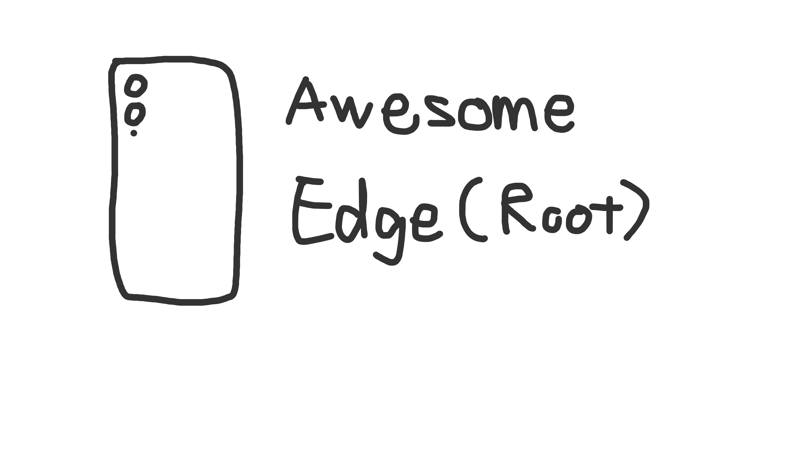

## Awesome edge

Personal Galaxy S25 Edge root note

개인적 갤럭시 S25 엣지 루팅 노트

More detailed list can found on [Awesome-android-root](https://github.com/awesome-android-root/awesome-android-root).

### Firmware
- [S937NKSSBDZJ2](https://samfw.com/firmware/SM-S937N/KOO/S937NKSSBDZJ2): Security patch 2026-10-05, Maybe last version of Dirtyfrag working

### Root
- [DFRoot](https://github.com/diabl0w/DFRoot): Dirtyfrag root
- [KernelSU-samsung](https://github.com/diabl0w/KernelSU): KernelSU for Galaxy
- [Porter](https://github.com/d4rken-org/porter): shizuku replacement

### KernelSU Modules
- [NoMount](https://github.com/maxsteeel/nomount): base VFS system
- [AdGuard CA for NoMount](https://github.com/craftingmod/Adguard-CA-NoMount): Adguard system cert for NoMount
- [apex-apps](https://github.com/privshell/apex-apps): Enable/Disable apps
  - disable `com.sec.android.soagent` / `com.wssyncmldm`

### Toolkit
- [Activity Manager](https://github.com/sdex/ActivityManager): Access specific activities
- [InstallerX Revived](https://github.com/wxxsfxyzm/InstallerX-Revived): Install apk variants without sus security something guard

### OneUI
- [Fingerpirnt Enhancer](https://github.com/asdfasdf-asdfasdf/FingerprintAccuracyEnhancer): Unlock fingerprint scanner - [Google Drive](https://drive.google.com/file/d/1x8p6Hiu-YWcGiZQ3r6Z8zJMrrLcajCFJ/view)
- [SamFonts](https://github.com/fahadalijaved/SamFonts): Use custom fonts in OneUI

### Misc
- [Morphe Manager](https://github.com/MorpheApp/morphe-manager): Use for app patching (NoMount mode)
- [Obtainium](https://github.com/ImranR98/Obtainium): FOSS App updater
- [Droid-ify](https://github.com/Droid-ify/client): FDroid client
- [Duck detector](https://github.com/eltavine/Duck-Detector-Refactoring): Root detector test before Korean *super-duper-permission-hungry-insecure-adware-trash* apps.

### VM (Experimental)
- [DroidVM](https://github.com/droid-vm/droidvm): VM experiment on 8Elite protected vm